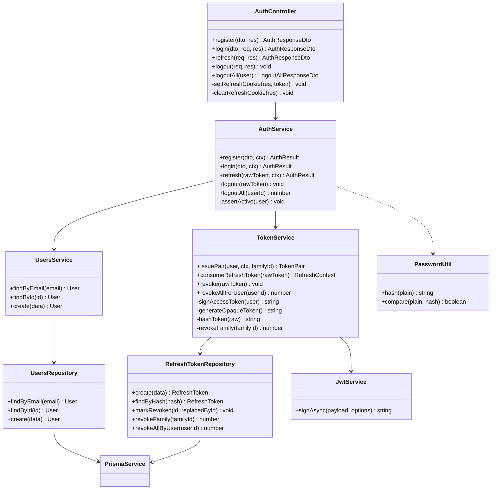
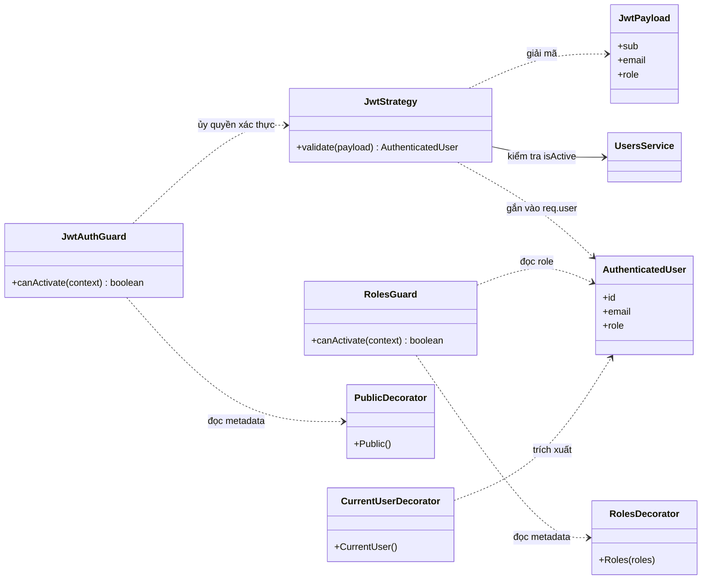

# Kiến trúc module Auth — Giai đoạn 1

Sơ đồ lớp cho module xác thực: đăng ký, đăng nhập, xoay vòng refresh token và bảo vệ
route theo vai trò.

## Phạm vi

**Có trong bản này**

- Đăng ký & đăng nhập bằng email + mật khẩu
- Access token dạng JWT, sống ngắn
- Refresh token dạng chuỗi ngẫu nhiên, lưu hash trong DB
- Xoay vòng token + phát hiện tái sử dụng
- Đăng xuất một phiên và đăng xuất toàn bộ thiết bị
- Phân quyền theo `Role`: ADMIN / MENTOR / MENTEE

**Chưa có trong phạm vi**

- Xác thực hai lớp (2FA)
- Xác minh email, quên mật khẩu
- Đăng nhập qua Google / OAuth
- Khóa tài khoản sau N lần sai mật khẩu
- Phân quyền chi tiết theo permission

## Sơ đồ lớp — luồng xác thực



## Sơ đồ lớp — bảo vệ route



## Trách nhiệm từng lớp

| Lớp | Trả lời câu hỏi | Sở hữu dữ liệu |
|---|---|---|
| `AuthController` | Request HTTP này ánh xạ sang thao tác nghiệp vụ nào? | Cookie, header, mã trạng thái |
| `AuthService` | Người này là ai, có được vào không? | Không truy vấn DB trực tiếp |
| `TokenService` | Token này còn hiệu lực không, cấp cái mới ra sao? | Bảng `RefreshToken` |
| `UsersService` | Người dùng này tồn tại không, thông tin là gì? | Bảng `User` |
| `PasswordUtil` | Chuỗi này có khớp hash không? | Không có trạng thái |
| `JwtStrategy` | Người mang token này còn được coi là hợp lệ không? | Ghi vào `req.user` |
| `JwtAuthGuard` | Route này có yêu cầu đăng nhập không? | Không có trạng thái |
| `RolesGuard` | Vai trò này có đủ để vào route không? | Không có trạng thái |

## DTO — dữ liệu qua ranh giới HTTP

| DTO | Trường | Ràng buộc |
|---|---|---|
| `RegisterDto` | email, password, fullName | Email hợp lệ, lowercase. Mật khẩu 8–72 ký tự, có chữ thường/hoa/số. Họ tên 2–100 ký tự |
| `LoginDto` | email, password | Chỉ kiểm tra không rỗng — không áp luật độ mạnh |
| `AuthUserDto` | id, email, fullName, role, avatarPath | Response. Không bao giờ chứa `passwordHash` |
| `AuthResponseDto` | accessToken, expiresIn, user | Response. Refresh token **không** ở đây, nó đi bằng cookie |
| `LogoutAllResponseDto` | revoked | Số phiên vừa bị thu hồi |

## Kiểu nội bộ — không lộ ra ngoài

| Kiểu | Trường | Vai trò |
|---|---|---|
| `JwtPayload` | sub, email, role | Nội dung bên trong access token |
| `AuthenticatedUser` | id, email, role | Thứ gắn vào `req.user` sau xác thực |
| `TokenPair` | accessToken, expiresIn, refreshToken, refreshExpiresAt, familyId | Kết quả `issuePair()` |
| `RefreshContext` | userId, familyId | Kết quả `consumeRefreshToken()` |
| `AuthResult` | user, tokenPair | Kết quả mọi thao tác của `AuthService` |
| `RequestContext` | userAgent, ipAddress | Dấu vết phiên, ghi kèm mỗi refresh token |

## Nguyên tắc thiết kế

### Chỉ controller biết đến HTTP

`AuthService` nhận dữ liệu thuần và trả `AuthResult`; nó không đụng `Request`,
`Response` hay cookie. Test service không cần dựng đối tượng HTTP giả.

### Xoay vòng token là ba bước, không phải một

Gộp vào `TokenService.rotate()` sẽ buộc `TokenService` truy vấn bảng `User` để lấy dữ
liệu ký token mới — phá vỡ ranh giới "mỗi service sở hữu đúng một vùng dữ liệu".

```
AuthService.refresh(rawToken, ctx)
  1. tokenService.consumeRefreshToken(rawToken)  -> { userId, familyId }
  2. usersService.findById(userId) + assertActive -> user
  3. tokenService.issuePair(user, ctx, familyId) -> TokenPair
```

### Refresh token không phải JWT

Nó là chuỗi ngẫu nhiên, hash trước khi ghi DB. Một JWT đã ký thì *không thu hồi được*
— nó hợp lệ tới khi hết hạn bất kể bạn làm gì. Không có bản ghi DB thì `logout`,
`logoutAll` và phát hiện tái sử dụng đều không tồn tại được.

### Hướng phụ thuộc một chiều

`UsersService` không biết gì về auth. Khi làm module `users` đầy đủ ở giai đoạn sau,
bạn thêm vào chứ không phải gỡ rối phụ thuộc vòng.

### Guard mở mặc định là sai

`JwtAuthGuard` đăng ký global, `@Public()` là ngoại lệ. Nếu ngược lại, endpoint quên
gắn guard sẽ im lặng để lộ dữ liệu — không lỗi, không cảnh báo.

## Bất biến phải giữ

| Bất biến | Hậu quả nếu vi phạm |
|---|---|
| Refresh token gốc không bao giờ ghi vào DB, chỉ ghi hash | Ai đọc được DB là đăng nhập được mọi tài khoản |
| Mỗi refresh token dùng đúng một lần, dùng xong đánh dấu `revokedAt` | Token bị copy dùng song song mà không ai phát hiện |
| Token đã thu hồi mà được dùng lại ⇒ thu hồi toàn bộ family | Kẻ trộm token duy trì truy cập vô thời hạn |
| Đăng nhập sai trả cùng thông báo dù sai email hay sai mật khẩu | Kẻ tấn công dò được email nào đã đăng ký |
| `passwordHash` không bao giờ rời khỏi tầng service | Lộ hash, mở đường tấn công offline |
| Email luôn lowercase trước khi ghi và trước khi tra cứu | Hai tài khoản trùng email khác hoa thường |
