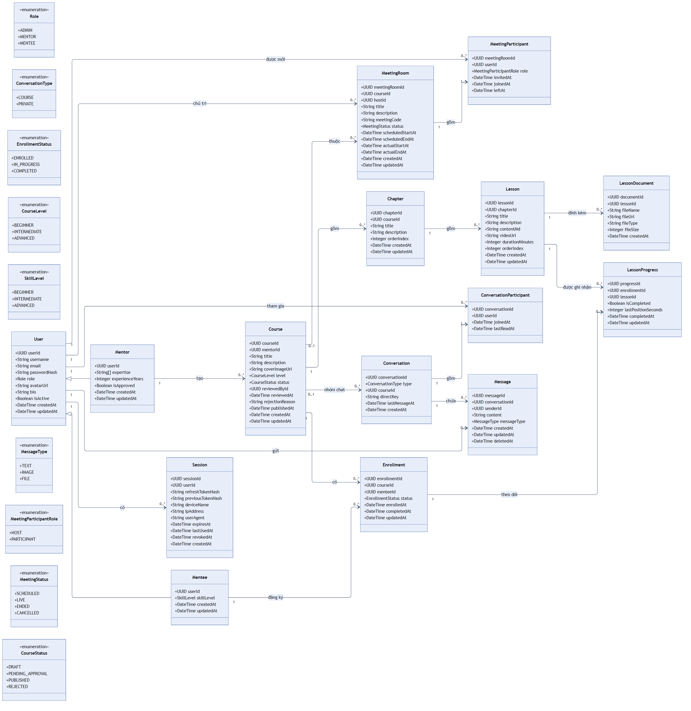
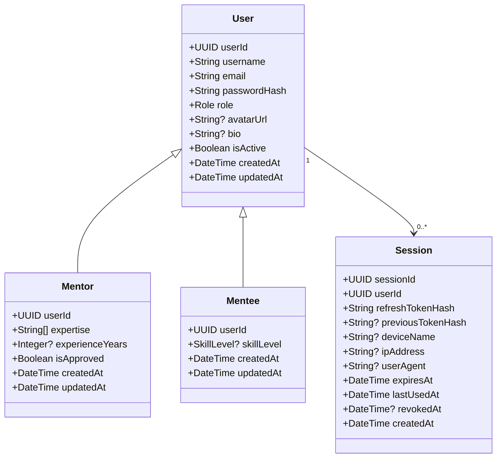
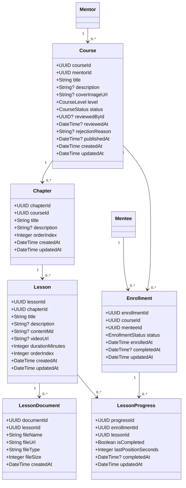
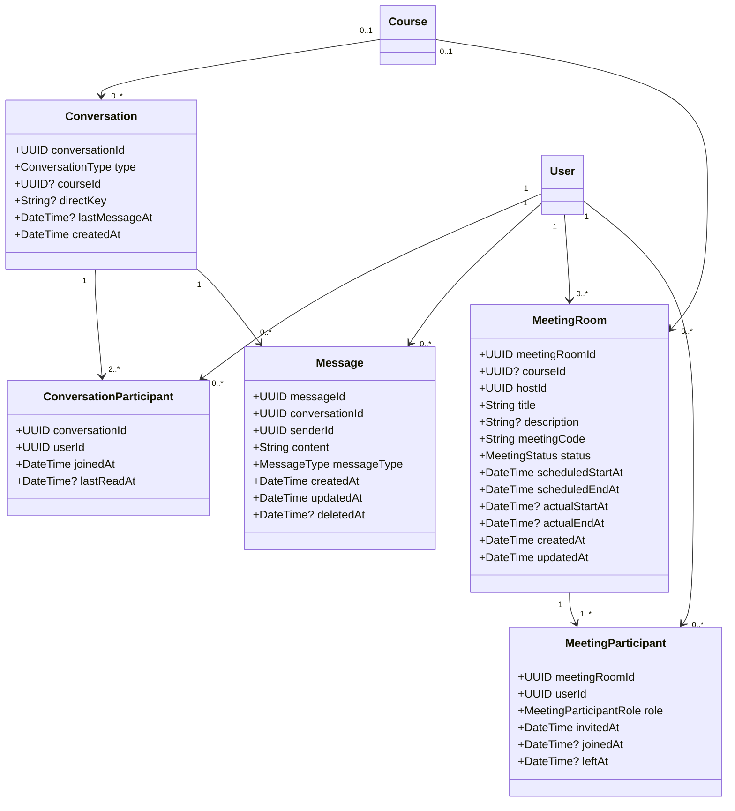

# Class diagram v2 — Learnova

Bản chỉnh sửa từ sơ đồ v1, đã áp dụng các quyết định thiết kế và xử lý những vấn đề đã
nêu trong buổi review.

---

## Sơ đồ tổng toàn hệ thống



File gốc: [diagrams/system-class-diagram.mmd](diagrams/system-class-diagram.mmd) ·
Bản vector để phóng to hoặc chèn vào báo cáo:
[diagrams/system-class-diagram.svg](diagrams/system-class-diagram.svg)

**Quy ước đường nối**

| Ký hiệu | Ý nghĩa |
|---|---|
| Mũi tên tam giác rỗng `◁—` | Kế thừa: `Mentor` và `Mentee` **là** `User` |
| Mũi tên đặc `——▶` | Association, kèm bội số ở hai đầu và tên vai trò ở giữa |

Sơ đồ được sinh bằng ELK layout nên mọi đường nối đều vuông góc và đi theo làn riêng —
không có đường chéo cắt nhau. Khi cần lần theo một quan hệ, đi dọc theo làn đó tới khi
gặp đầu mũi tên.

**Sinh lại ảnh sau khi sửa file `.mmd`**

```bash
npm i -D @mermaid-js/mermaid-cli
npx mmdc -i docs/diagrams/system-class-diagram.mmd \
         -o docs/diagrams/system-class-diagram.png -b white -s 3
```

Lưu ý: **đừng đặt `fontFamily` trong `themeVariables`**. Mermaid đo bề rộng chữ bằng
font mặc định nhưng lại vẽ bằng font bạn chỉ định, nên chữ dài hơn ô và bị cắt mất ký
tự cuối — lỗi này chỉ lộ ra trong ảnh xuất, không thấy khi xem preview.

Ba sơ đồ tách theo cụm ở các mục bên dưới dễ đọc hơn khi cần xem chi tiết từng phần.

---

## Quyết định đã chốt

| Quyết định | Hệ quả lên mô hình |
|---|---|
| File/ảnh/video lưu trên dịch vụ bên thứ ba | Mọi cột chứa media lưu **URL đầy đủ**, không phải path. Giữ nguyên `avatarUrl`, `coverImageUrl`, `videoUrl`, `fileUrl` |
| Tin nhắn không phải text thì lưu link vào `content` | Không có bảng `MessageAttachment`. `content` là `String` cho mọi loại tin nhắn |
| Không làm tính năng logout-all | `Session` không cần `familyId` để gom nhóm phiên. Xem mục [Đề xuất lưu session](#đề-xuất-lưu-session) |
| Mentor không học khóa học khác | `User.role` giữ nguyên dạng đơn trị. Một `User` chỉ có một trong hai profile |
| Bỏ `Mentor.specialization` | Đã bỏ |
| Tìm khóa học bằng tên khóa học, không lọc theo kỹ năng | **Không có** bảng `Skill`, `MentorSkill`, `MenteeInterest`. `Mentor.expertise` là mảng chuỗi ngay trên profile |
| Bỏ `Mentee.interests` | Đã bỏ. Không có màn hình nào đọc tới sở thích tự khai |
| Chat trong phòng họp là realtime, không lưu DB | `Conversation`/`Message` chỉ phục vụ messenger. Không có bảng nào cho chat phòng họp, không có quan hệ giữa `MeetingRoom` và `Conversation` |

**Đánh đổi cần biết khi lưu link vào `content`:** hệ thống không giữ tên file gốc và
dung lượng. Client sẽ hiển thị tên suy ra từ URL (`.../a3f9c2.pdf` thay vì
`Bai_giang_React.pdf`) và không cảnh báo được "file 200MB, tải không?". Với phạm vi
đồ án thì chấp nhận được; nếu sau này cần, thêm hai cột nullable `fileName` và
`fileSize` vào `Message` là đủ, không phải đổi cấu trúc.

---

## Tóm tắt thay đổi so với v1

| # | Vấn đề ở v1 | Cách xử lý ở v2 |
|---|---|---|
| 1 | `User 1 — 1 Session` | Đổi thành `1 — 0..*` |
| 2 | `Session` không phát hiện được token bị đánh cắp | Thêm `previousTokenHash` + `lastUsedAt`, kèm thuật toán xoay vòng |
| 3 | Không có bảng lưu tiến độ học | Thêm `LessonProgress` |
| 4 | Bảng nối thiếu ràng buộc duy nhất | Đặt PK tổ hợp cho `ConversationParticipant`, `MeetingParticipant`; `UNIQUE` cho `Enrollment`, `meetingCode` |
| 5 | `expertise`/`interests` là chuỗi tự do một dòng | `expertise` đổi sang `String[]`, giá trị hợp lệ khai báo cố định trong code. `interests` bỏ hẳn |
| 6 | `bio` trùng ở `Mentor` và `Mentee` | Dời lên `User` |
| 7 | `Course.memberCount` là dữ liệu dẫn xuất | Bỏ, đếm từ `Enrollment` |
| 8 | Hội thoại `PRIVATE` có thể bị tạo trùng | Thêm `directKey` UNIQUE |
| 9 | `MeetingRoom` có 4 cột thời gian kết thúc | Còn 3, ngữ nghĩa rõ ràng |
| 10 | Không biết ai thực sự vào phòng họp | `MeetingParticipant` thêm `joinedAt`, `leftAt` |
| 11 | Duyệt khóa học không lưu ai duyệt, lý do từ chối | `Course` thêm `reviewedById`, `reviewedAt`, `rejectionReason` |
| 12 | Mentor chưa duyệt vẫn tạo được khóa học | `Mentor` thêm `isApproved` |
| 13 | `CourseLevel` được dùng nhưng chưa định nghĩa | Đã định nghĩa |
| 14 | Enum `Meeting Status` có dấu cách | Đổi thành `MeetingStatus` |
| 15 | Thiếu `createdAt`/`updatedAt` ở nhiều bảng | Bổ sung nhất quán |
| 16 | `duration` không rõ đơn vị | Đổi thành `durationMinutes` |

---

## Enum

```
Role                    ADMIN · MENTOR · MENTEE
CourseLevel             BEGINNER · INTERMEDIATE · ADVANCED
CourseStatus            DRAFT · PENDING_APPROVAL · PUBLISHED · REJECTED
EnrollmentStatus        ENROLLED · IN_PROGRESS · COMPLETED
SkillLevel              BEGINNER · INTERMEDIATE · ADVANCED
ConversationType        COURSE · PRIVATE
MessageType             TEXT · IMAGE · FILE
MeetingStatus           SCHEDULED · LIVE · ENDED · CANCELLED
MeetingParticipantRole  HOST · PARTICIPANT
```

`CourseLevel` và `SkillLevel` cùng tập giá trị nhưng để riêng: một cái mô tả độ khó
của khóa học, một cái mô tả năng lực người dùng. Gộp chung thì sau này muốn thêm
`EXPERT` cho kỹ năng sẽ kéo theo khóa học cũng có `EXPERT`.

---

## Sơ đồ 1 — Người dùng và phiên đăng nhập



### Khóa và ràng buộc

| Bảng | PK | UNIQUE | FK |
|---|---|---|---|
| `User` | `userId` | `username`, `email` | — |
| `Session` | `sessionId` | `refreshTokenHash`, `previousTokenHash` | `userId` → `User` CASCADE |
| `Mentor` | `userId` | — | `userId` → `User` CASCADE |
| `Mentee` | `userId` | — | `userId` → `User` CASCADE |

`Mentor.userId` và `Mentee.userId` vừa là khóa chính vừa là khóa ngoại — đây là cách
diễn đạt quan hệ 1-1 trong SQL, và nó tự động ngăn một người có hai profile mentor.

### `Mentor.expertise` là mảng chuỗi, không phải bảng riêng

Cột này chỉ để **hiển thị trên trang profile mentor**. Người học tìm khóa học bằng tên
khóa học, không lọc theo kỹ năng — nên bảng danh mục kỹ năng, bảng nối mentor–kỹ năng
và màn hình quản trị đi kèm đều không có gì đọc tới.

Dùng `String[]` (kiểu `text[]` của Postgres, Prisma hỗ trợ sẵn) thay vì một chuỗi dài
ngăn cách bằng dấu phẩy: client render thành từng chip riêng mà không phải tự tách
chuỗi, và nếu sau này cần lọc thì Postgres vẫn làm được bằng `hasSome` với index GIN.

Để tránh mỗi người gõ một kiểu (`"ReactJS"` / `"React.js"` / `"react"`), khai báo một
danh sách giá trị hợp lệ cố định trong code và cho DTO chỉ chấp nhận giá trị nằm trong
đó. Được phần lớn lợi ích của việc chuẩn hóa mà không cần thêm bảng nào.

`Mentee` không có cột tương ứng: sở thích tự khai không có màn hình nào đọc tới, và
nếu sau này cần gợi ý khóa học thì lịch sử `Enrollment` là tín hiệu tốt hơn nhiều.

### Về quan hệ kế thừa trên sơ đồ

`Mentor` và `Mentee` vẽ bằng mũi tên kế thừa vì về mặt khái niệm chúng **là** `User`.
Nhưng quan hệ đó không tồn tại trong database — SQL không có kế thừa bảng. Nó được
hiện thực hóa bằng cách cho `Mentor.userId` và `Mentee.userId` vừa là khóa chính vừa
là khóa ngoại trỏ về `User.userId`. Prisma gọi đây là quan hệ 1-1.

**`username`** hiện đóng vai trò tên hiển thị. Nếu sau này cần tách tên đăng nhập khỏi
tên hiển thị thì thêm cột `fullName`, không phải đổi cấu trúc.

---

## Sơ đồ 2 — Khóa học và tiến độ học



### Khóa và ràng buộc

| Bảng | PK | UNIQUE | FK |
|---|---|---|---|
| `Course` | `courseId` | — | `mentorId` → `Mentor` RESTRICT · `reviewedById` → `User` SET NULL |
| `Chapter` | `chapterId` | `(courseId, orderIndex)` | `courseId` → `Course` CASCADE |
| `Lesson` | `lessonId` | `(chapterId, orderIndex)` | `chapterId` → `Chapter` CASCADE |
| `LessonDocument` | `documentId` | — | `lessonId` → `Lesson` CASCADE |
| `Enrollment` | `enrollmentId` | `(courseId, menteeId)` | `courseId` → `Course` RESTRICT · `menteeId` → `Mentee` CASCADE |
| `LessonProgress` | `progressId` | `(enrollmentId, lessonId)` | `enrollmentId` → `Enrollment` CASCADE · `lessonId` → `Lesson` CASCADE |

### Vì sao bội số đổi từ `1..*` thành `0..*`

Ở v1, `Course 1 — 1..* Chapter` nghĩa là **không thể tạo một khóa học rỗng**. Nhưng
mentor luôn phải tạo khóa học trước rồi mới thêm chương — tại thời điểm bấm "Tạo khóa
học", khóa học có 0 chương. Ràng buộc `1..*` khiến trạng thái `DRAFT` không tồn tại
được. Tương tự cho `Chapter — Lesson`.

Điều kiện "phải có ít nhất một chương" là luật của **hành động chuyển sang
`PENDING_APPROVAL`**, không phải luật của cấu trúc dữ liệu.

### `LessonProgress` gắn vào `Enrollment`, không phải `Mentee`

Nếu gắn vào `menteeId`, khi một người hủy khóa học rồi đăng ký lại, tiến độ cũ sẽ lẫn
vào lần học mới — hệ thống báo "đã hoàn thành 80%" trong khi người dùng vừa bắt đầu
lại từ đầu. Gắn vào `enrollmentId` thì mỗi lần đăng ký là một lần học độc lập.

### Quy tắc chuyển `EnrollmentStatus`

```
ENROLLED       khi tạo Enrollment
    ↓          khi LessonProgress đầu tiên được ghi
IN_PROGRESS
    ↓          khi mọi Lesson của Course đều có isCompleted = true
COMPLETED      → ghi completedAt
```

Đây là trạng thái được tính từ `LessonProgress` rồi lưu lại, chứ không phải nguồn sự
thật độc lập. Mọi cập nhật `LessonProgress` phải nằm cùng transaction với việc tính
lại `Enrollment.status`.

---

## Sơ đồ 3 — Messenger và phòng họp

Hai nhóm bảng trong sơ đồ này **không liên quan đến nhau**: nhánh `Conversation` phục
vụ messenger, nhánh `MeetingRoom` phục vụ phòng họp. Chúng chỉ gặp nhau ở chỗ cùng
tham chiếu tới `User` và `Course`.



### Khóa và ràng buộc

| Bảng | PK | UNIQUE | FK |
|---|---|---|---|
| `Conversation` | `conversationId` | `directKey` | `courseId` → `Course` CASCADE |
| `ConversationParticipant` | `(conversationId, userId)` | — | cả hai, CASCADE |
| `Message` | `messageId` | — | `conversationId` → `Conversation` CASCADE · `senderId` → `User` RESTRICT |
| `MeetingRoom` | `meetingRoomId` | `meetingCode` | `courseId` → `Course` SET NULL · `hostId` → `User` RESTRICT |
| `MeetingParticipant` | `(meetingRoomId, userId)` | — | cả hai, CASCADE |

### Hai hệ thống nhắn tin tách rời nhau

Đây là điểm dễ hiểu nhầm khi đọc sơ đồ, nên nói rõ: **`Conversation` và `Message` chỉ
phục vụ tính năng messenger.** Chat trong phòng họp là một hệ thống khác hẳn.

| | Messenger | Chat phòng họp |
|---|---|---|
| Bảng dữ liệu | `Conversation`, `ConversationParticipant`, `Message` | **Không có** |
| Vòng đời tin nhắn | Vĩnh viễn | Chỉ tồn tại trong lúc phòng đang mở |
| Phạm vi | Giữa hai người, hoặc nhóm theo khóa học | Trong đúng một `MeetingRoom` |
| Cách truyền | WebSocket + ghi DB | WebSocket, phát rồi thôi |

Không có quan hệ nào giữa `MeetingRoom` và `Conversation` trong sơ đồ, và đó là chủ ý.

**Hệ quả cần chấp nhận** — nên ghi rõ trên giao diện để người dùng không mất dữ liệu
oan:

- Người vào phòng muộn không thấy tin nhắn đã gửi trước đó
- Đóng phòng hoặc mất kết nối là mất toàn bộ nội dung chat
- Không xuất được biên bản buổi học, không rà soát lại được nếu có báo cáo vi phạm

Nếu sau này cần lưu, thêm một bảng `MeetingMessage` riêng — **đừng** tái sử dụng
`Message`, vì hai loại tin nhắn có vòng đời và quy tắc truy cập hoàn toàn khác nhau.

**Về phía code:** hai gateway riêng biệt, không dùng chung.

```
modules/messages/messages.gateway.ts    -- nhận, ghi DB, rồi mới phát
modules/meetings/meeting.gateway.ts     -- chỉ phát lại cho room, không chạm DB
```

Một lưu ý triển khai: nếu backend chạy nhiều instance, chat phòng họp cần Redis adapter
cho Socket.IO — không có nó, hai người vào cùng phòng nhưng rơi vào hai instance khác
nhau sẽ không thấy tin nhắn của nhau. Triệu chứng này chỉ xuất hiện khi deploy nhiều
instance, không bao giờ lộ ra lúc chạy local.

### `directKey` — chặn hội thoại 1-1 bị tạo trùng

Không có nó, mỗi lần An mở khung chat với Bình lại sinh một `Conversation` mới và lịch
sử tin nhắn vỡ thành nhiều mảnh. Cách làm:

```
type = PRIVATE  →  directKey = min(userIdA, userIdB) + ":" + max(userIdA, userIdB)
type = COURSE   →  directKey = NULL
```

Sắp xếp hai id trước khi ghép để `An:Bình` và `Bình:An` cho ra cùng một chuỗi. Postgres
cho phép nhiều giá trị `NULL` trong cột `UNIQUE`, nên hội thoại khóa học không bị ảnh
hưởng.

### `MeetingRoom` — còn ba cột thời gian thay vì bốn

| Cột | Ý nghĩa |
|---|---|
| `scheduledStartAt` | Giờ hẹn bắt đầu |
| `scheduledEndAt` | Giờ hẹn kết thúc. **Gia hạn phòng = cập nhật chính cột này** |
| `actualStartAt` | Thời điểm phòng thực sự chuyển sang `LIVE` |
| `actualEndAt` | Thời điểm phòng thực sự đóng |

`currentEndAt` và `autoCloseAt` ở v1 đã bỏ. Việc gia hạn ghi đè `scheduledEndAt`, còn
job tự đóng phòng chỉ cần quét `status = LIVE AND scheduledEndAt < now()` — không cần
cột riêng.

### `MeetingRoom.courseId` cho phép NULL

Ở v1 cột này bắt buộc, nghĩa là mọi cuộc họp phải thuộc một khóa học. Buổi tư vấn 1-1
giữa mentor và mentee nằm ngoài khóa học sẽ không tạo được. Cho nullable là đủ.

---

## Đề xuất lưu session

Vì đã bỏ logout-all, mô hình "mỗi refresh token là một dòng + `familyId`" trở nên nặng
so với nhu cầu. Đề xuất: **mỗi thiết bị là một dòng, xoay vòng token bằng cặp
hash hiện hành / hash liền trước**.

### Cấu trúc

```
Session
  sessionId          UUID       PK
  userId             UUID       FK → User, ON DELETE CASCADE
  refreshTokenHash   Char(64)   UNIQUE, NOT NULL      -- token đang có hiệu lực
  previousTokenHash  Char(64)   UNIQUE, NULL          -- token vừa bị thay thế
  deviceName         Varchar(100)  NULL
  ipAddress          Varchar(45)   NULL
  userAgent          Varchar(255)  NULL
  expiresAt          DateTime   NOT NULL              -- cố định 30 ngày từ lúc đăng nhập
  lastUsedAt         DateTime   NOT NULL
  revokedAt          DateTime   NULL
  createdAt          DateTime   NOT NULL
```

Hash bằng **SHA-256**, không phải bcrypt. Refresh token là 256 bit ngẫu nhiên nên
không có gì để brute-force, và bcrypt sinh salt khác nhau mỗi lần nên không thể tra
bằng `WHERE token_hash = ?` — sẽ phải quét toàn bảng.

### Thuật toán xoay vòng

```
refresh(rawToken):
  h = sha256(rawToken)
  s = SELECT * FROM sessions
      WHERE refreshTokenHash = h OR previousTokenHash = h

  không tìm thấy               → 401
  s.revokedAt IS NOT NULL      → 401
  s.expiresAt < now()          → 401

  nếu h = s.previousTokenHash:
      now() - s.lastUsedAt < 10 giây  → 401, KHÔNG thu hồi   (xem "cửa sổ ân hạn")
      ngược lại                        → TÁI SỬ DỤNG:
                                          UPDATE revokedAt = now()
                                          401

  -- h = s.refreshTokenHash: hợp lệ, xoay vòng
  new = randomBytes(32)
  UPDATE sessions
     SET previousTokenHash = refreshTokenHash,
         refreshTokenHash  = sha256(new),
         lastUsedAt        = now()
   WHERE sessionId = s.sessionId

  trả accessToken mới + refresh token `new` qua cookie httpOnly
```

### Vì sao chỉ giữ hai hash là đủ

Kịch bản: kẻ tấn công copy được token `T2` khi nó đang có hiệu lực.

| Diễn biến | Kết quả |
|---|---|
| Kẻ tấn công dùng `T2` trước → nhận `T3'`. Người dùng thật gửi `T2` lên | `T2` giờ là `previousTokenHash` → **phát hiện** → thu hồi phiên, `T3'` chết theo |
| Người dùng thật dùng `T2` trước → nhận `T3`. Kẻ tấn công gửi `T2` | `T2` là `previousTokenHash` → **phát hiện** → thu hồi phiên |
| Kẻ tấn công chờ lâu, người dùng đã xoay vòng vài lần | `T2` không khớp cột nào → 401. Kẻ tấn công không lấy được gì, phiên thật vẫn an toàn |

Cả ba nhánh đều cho kết quả chấp nhận được. Mô hình `familyId` đầy đủ chỉ hơn ở chỗ
lưu được toàn bộ dấu vết để điều tra sau — thứ chưa cần ở phạm vi này.

### Cửa sổ ân hạn 10 giây

Đây là chi tiết sẽ cắn bạn lúc dev nếu không xử lý. Khi hai request refresh chạy song
song — React StrictMode gọi effect hai lần, hoặc người dùng mở hai tab — request thứ
hai gửi lên đúng cái token vừa bị thay thế. Không có cửa sổ ân hạn, hệ thống sẽ coi đó
là bị đánh cắp và **đăng xuất người dùng vô cớ**.

Trong 10 giây kể từ `lastUsedAt`, việc dùng lại token liền trước được coi là request
trùng lặp: trả 401 nhưng không thu hồi phiên. Client tự retry bằng cookie mới. Ngoài
cửa sổ đó thì coi là đánh cắp thật.

Phía client vẫn nên cài cơ chế single-flight cho refresh — cửa sổ ân hạn là lưới an
toàn, không phải giải pháp chính.

### `expiresAt` cố định, không gia hạn

Đặt 30 ngày tại thời điểm đăng nhập và **không đẩy ra xa mỗi lần refresh**. Nếu gia
hạn liên tục, một phiên hoạt động đều sẽ tồn tại vĩnh viễn — người dùng không bao giờ
phải đăng nhập lại, và token bị đánh cắp cũng vậy.

---

## Ràng buộc mà database không tự ép được

Những điều dưới đây phải do tầng ứng dụng đảm bảo. Ghi lại ở đây vì chúng là loại lỗi
âm thầm, không có thông báo khi vi phạm.

| Bất biến | Thực thi ở đâu |
|---|---|
| `User.role = MENTOR` ⟺ tồn tại dòng trong `Mentor` (tương tự cho `MENTEE`) | Tạo `User` và tạo profile trong **cùng một transaction** |
| `Conversation.type = COURSE` ⟹ `courseId` NOT NULL; `type = PRIVATE` ⟹ `courseId` NULL và `directKey` NOT NULL | `CHECK` constraint hoặc kiểm tra ở service |
| Hội thoại `PRIVATE` có đúng 2 người tham gia | Service — bội số `2..*` trên sơ đồ không ép được ở tầng DB |
| Mỗi `MeetingRoom` có đúng một `MeetingParticipant` vai trò `HOST` | Service |
| `Course` chỉ chuyển sang `PENDING_APPROVAL` khi có ≥ 1 chương và mỗi chương có ≥ 1 bài | Service |
| `Course` chỉ tạo được bởi `Mentor` có `isApproved = true` | Service hoặc guard |
| `email` luôn lowercase trước khi ghi và trước khi tra cứu | DTO transform + unique index theo `lower(email)` |
| `LessonProgress` chỉ ghi được cho `Lesson` thuộc `Course` mà `Enrollment` trỏ tới | Service — không có FK nào diễn đạt được ràng buộc chéo này |

Dòng cuối đáng chú ý: cấu trúc hiện tại cho phép ghi tiến độ của một bài học thuộc
khóa A vào một enrollment của khóa B. Không có ràng buộc khóa ngoại nào chặn được, vì
`LessonProgress` trỏ tới `Lesson` và `Enrollment` một cách độc lập.

---

## Index cần có

| Bảng | Index | Phục vụ |
|---|---|---|
| `Session` | `userId` | Liệt kê thiết bị đang đăng nhập |
| `Message` | `(conversationId, createdAt DESC)` | Phân trang tin nhắn — đường nóng nhất của chat |
| `Conversation` | `lastMessageAt DESC` | Sắp xếp danh sách hội thoại |
| `ConversationParticipant` | `userId` | Lấy danh sách hội thoại của một người |
| `Enrollment` | `menteeId` | Trang "Khóa học của tôi" |
| `LessonProgress` | `enrollmentId` | Tính phần trăm hoàn thành |
| `Chapter` | `(courseId, orderIndex)` | Đã có qua UNIQUE |
| `Lesson` | `(chapterId, orderIndex)` | Đã có qua UNIQUE |
| `Course` | `(status, level)` | Lọc danh sách khóa học công khai |
| `Course` | GIN trigram trên `title` | Tìm khóa học theo tên — đây là **cách tìm kiếm duy nhất** của hệ thống, xem ghi chú bên dưới |
| `MeetingRoom` | `(status, scheduledEndAt)` | Job tự đóng phòng quá giờ |

### Tìm khóa học theo tên

Vì đây là con đường tìm kiếm duy nhất, nó xứng đáng được làm cho tử tế. Truy vấn dạng
`WHERE title ILIKE '%react%'` **không dùng được B-tree index** — dấu `%` ở đầu chuỗi
làm index vô hiệu, Postgres sẽ quét toàn bảng. Với vài trăm khóa học thì không ai nhận
ra, nhưng đó là thói quen xấu.

Hai cách xử lý, theo thứ tự công sức tăng dần:

```sql
-- 1. Trigram: tìm gần đúng, chịu được gõ sai chính tả
CREATE EXTENSION IF NOT EXISTS pg_trgm;
CREATE INDEX course_title_trgm ON courses USING GIN (title gin_trgm_ops);
-- rồi ILIKE '%react%' dùng được index

-- 2. Full-text search: tìm theo từ, có xếp hạng độ liên quan
ALTER TABLE courses ADD COLUMN search_vector tsvector
  GENERATED ALWAYS AS (to_tsvector('simple', title)) STORED;
CREATE INDEX course_search ON courses USING GIN (search_vector);
```

Với tiếng Việt, cách 1 thường cho kết quả tốt hơn vì Postgres không có bộ phân tích
tiếng Việt sẵn — full-text search sẽ tách từ theo khoảng trắng và bỏ lỡ nhiều trường
hợp. Prisma không sinh được cả hai loại index này, phải viết migration tay.

---

## Vẫn còn để ngỏ

Không nằm trong bản này, cân nhắc thêm nếu phạm vi đồ án cho phép:

- **Đánh giá khóa học** — `CourseReview(courseId, menteeId, rating, comment)`, `UNIQUE(courseId, menteeId)`
- **Danh mục khóa học** — `Category` + `CourseCategory`. Chỉ làm nếu có màn hình duyệt theo danh mục; nếu chỉ tìm bằng tên khóa học thì không cần
- **Thông báo** — `Notification(userId, type, payload, readAt)`
- **Quiz cuối bài** — kéo theo `Question`, `Option`, `QuizAttempt`; đây là nhánh lớn, nên là việc cuối cùng
- **Xóa mềm cho `Course`** — hiện tại xóa khóa học sẽ CASCADE mất toàn bộ chương, bài và tiến độ học của mọi mentee. Nếu điều đó không chấp nhận được thì đổi sang `deletedAt` thay vì xóa thật
